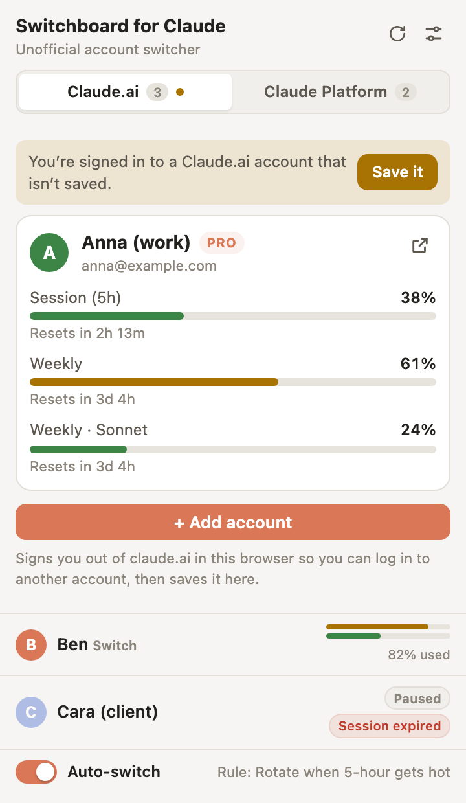
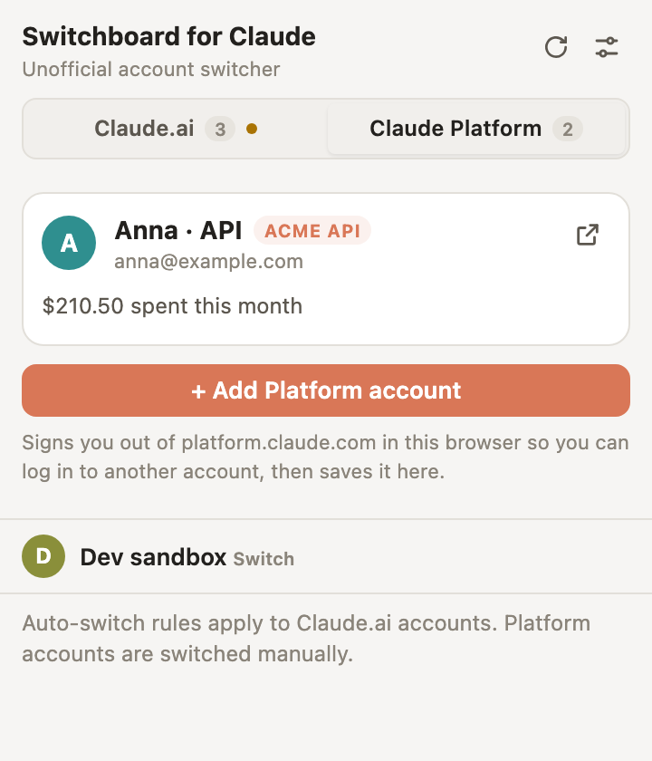
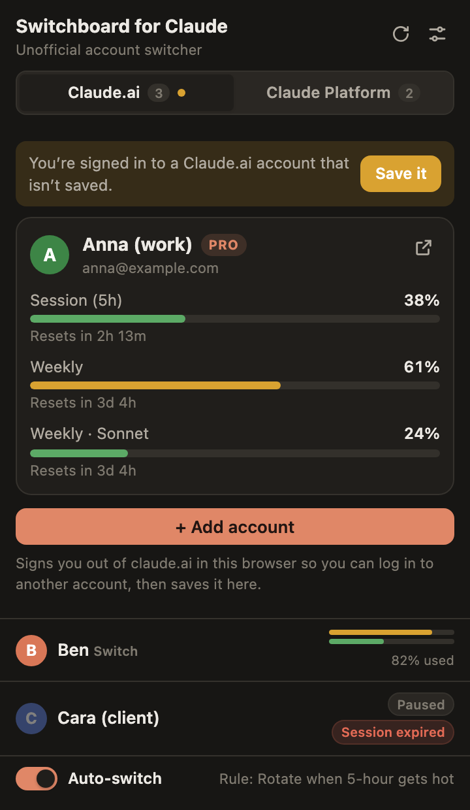
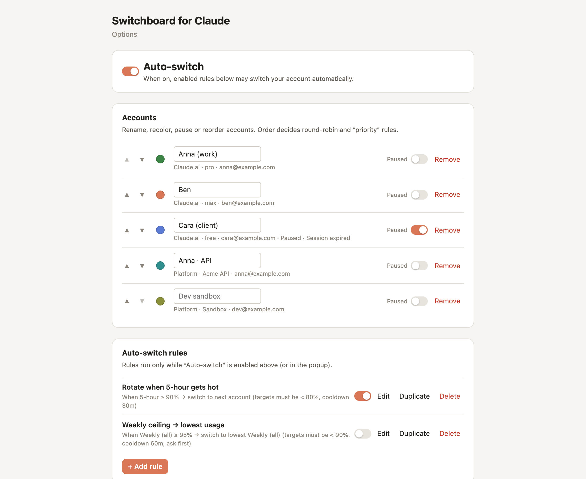
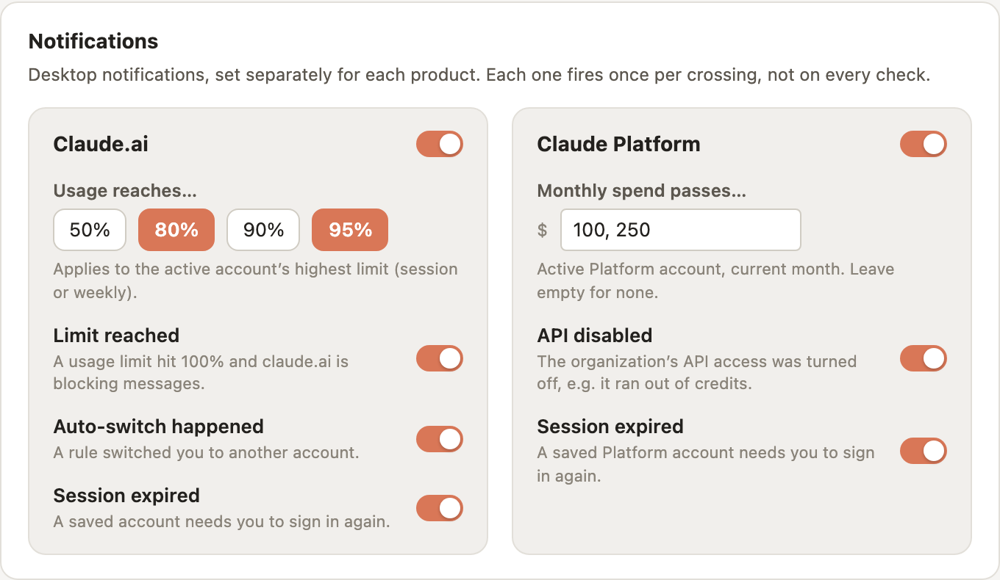

# Switchboard for Claude

> **Unofficial** — not affiliated with, endorsed by, or sponsored by Anthropic.
> **Claude** is a trademark of Anthropic, PBC.

Switchboard for Claude is an open-source Chrome extension (Manifest V3) for people who use **multiple Claude accounts**. It keeps your claude.ai accounts one click away, tracks each account's usage limits, and can automatically switch to a less-used account before you hit a wall. It also manages your **Claude Platform** (platform.claude.com) accounts, so switching between API organizations is one click too.


## Features

- **One-click account switching** — swap between saved claude.ai accounts instantly from the toolbar popup, the options page, or the keyboard shortcut **Alt+Shift+N** (customizable at `chrome://extensions/shortcuts`).
- **Usage-limit tracking** — see how much of each account's limits is used: the **5-hour session** window, **weekly** windows (including per-model weekly limits, where applicable), and any other limit tiers claude.ai reports, with reset times, directly in the popup and as an optional toolbar badge (badge metric configurable, e.g. "highest limit").
- **Auto-switch rules** — define rules like "when my 5-hour usage passes 90%, switch to the account with the lowest usage" and let Switchboard handle the rotation (with cooldowns and optional confirmation prompts).
- **Claude Platform accounts** — save and switch platform.claude.com (API / Console) accounts independently of claude.ai, with this month's spend shown when available.
- **Notifications, per product** — claude.ai: usage thresholds (default 80% and 95%), limit reached, automatic switches, expired sessions. Claude Platform: monthly spend passing amounts you choose, API disabled (e.g. out of credits), expired sessions.
- **Add-account flow** — log in to a new claude.ai account and capture it into Switchboard without losing your existing ones.
- **Labels & colors** — name and color-code accounts so "Work", "Personal", and "Client X" are obvious at a glance.
- **Encrypted export/import** — back up your setup, including sessions, protected by a passphrase.
- **Everything stays local** — no servers, no sync, no analytics, no telemetry. See [Privacy & security](#privacy--security).

## Screenshots

All screenshots use dummy data.

| Claude.ai accounts | Claude Platform accounts | Dark mode |
|---|---|---|
|  |  |  |

**Options** — accounts, auto-switch rules, notifications, history and backup:



**Notifications**, set separately for claude.ai and Claude Platform:



## Installation

### Chrome Web Store

**Coming soon.** The store listing is in preparation; until then use one of the methods below.

### Load unpacked from a release zip

1. Download `claude-switchboard.zip` from the [latest GitHub release](../../releases/latest).
2. Unzip it to a folder you won't delete (Chrome loads the extension from that folder).
3. Open `chrome://extensions`, enable **Developer mode** (top right).
4. Click **Load unpacked** and select the unzipped folder.
5. Pin "Switchboard for Claude" to your toolbar.

### Build from source

Requires **Node.js 22+**.

```sh
git clone https://github.com/dotKa/claude-switchboard.git
cd claude-switchboard
npm ci
npm run build       # type-checks and builds into dist/
# or: npm run zip   # builds and produces claude-switchboard.zip
```

Then load the `dist/` folder as an unpacked extension (steps 3–5 above). During development, `npm run dev` rebuilds on every change; click the reload icon on the extension card in `chrome://extensions` after each build.

## Getting started

1. Sign in to claude.ai in Chrome as usual.
2. Open the Switchboard popup and click **Save current account** — Switchboard captures the session and shows it in your account list.
3. Use **Add account** to sign into another claude.ai account (Switchboard clears the local claude.ai session cookie and opens the claude.ai login page; your saved accounts are untouched). Once signed in, save that account too.
4. Click any account in the popup to switch to it. Open claude.ai tabs are briefly parked on a "Switching account…" page while the session is swapped, then return to a new chat — this keeps claude.ai from signing the new session out.

## Claude Platform accounts

The popup has two tabs: **Claude.ai** and **Claude Platform**. They are independent — each has its own active account, and switching one never touches the other's session.

Platform support is about **account management**: save, add, switch, label and remove platform.claude.com accounts. Usage is intentionally light: the active Platform account shows this month's spend (from the Console's own `current_spend` endpoint) when it is available, and the options page can notify you when spend passes amounts you set or when the organization's API access is disabled. Auto-switch rules and the toolbar badge apply to claude.ai accounts only.

## How account switching works

claude.ai and platform.claude.com each identify your session with an HTTP cookie named `sessionKey`. Switchboard stores a copy of each saved account's `sessionKey` **locally in your browser** (`chrome.storage.local`). When you switch accounts, the extension replaces the current `sessionKey` cookie with the stored one and (optionally) reloads your open claude.ai tabs so they pick up the new session.

This means:

- Switchboard never sees or stores your password. Sessions are captured from — and applied to — your own browser only.
- A stolen `sessionKey` is as good as a stolen login. **Treat exports like passwords**, and see [Privacy & security](#privacy--security).
- The exact scope of the Claude Platform `sessionKey` cookie isn't publicly documented and hasn't been independently confirmed: it may be host-only to `platform.claude.com`, or it may be scoped to the broader `.claude.com` domain. Switchboard reuses whatever scope the cookie already has when switching, so if Anthropic does scope it to `.claude.com`, switching your Claude Platform account would also change the session on any other `*.claude.com` site sharing that cookie.

## Usage tracking

For Claude Platform accounts, see [Claude Platform accounts](#claude-platform-accounts). For claude.ai, usage numbers come from the same claude.ai endpoint that the claude.ai settings/usage page itself uses (an endpoint of the form `/api/organizations/{org}/usage`, queried with each account's session). Switchboard normalizes whatever limit entries the endpoint reports — session, weekly, and model-specific limits — and can flag "limit reached" when any reported limit hits 100%.

**This is an unofficial, undocumented API.** Anthropic can change or remove it at any time without notice. When that happens, usage display may fail or report stale data until the extension is updated. Please [open an "endpoint broke" issue](../../issues/new?template=endpoint_broke.yml) if you suspect this.

## Auto-switch rules

Rules watch a condition and switch accounts when it fires. Each rule has:

- a **condition**: usage of a metric above X%, a hard limit reached, or a daily schedule;
- a **target**: next account in rotation, the account with the lowest usage of a metric, your priority-ordered list, or one specific account;
- a **target ceiling** (optional): only accounts below this usage % are eligible targets;
- a **cooldown**: minimum minutes between automatic switches;
- **confirm**: ask via a notification instead of switching silently.

Accounts marked **paused** are excluded from automatic rotation.

### Examples

| Condition | Target | Ceiling | Effect |
|---|---|---|---|
| 5-hour usage above 90% | Lowest 5-hour usage | 80% | When the active account is nearly exhausted, jump to the least-used account that's still under 80%. |
| Hard limit reached | Next in rotation | — | When claude.ai rate-limits you, move straight to the next eligible account. |
| Daily at 09:00 | Priority order | 50% | Every morning, start the day on your highest-priority account that isn't already half-used. |

Automatic switching is **off by default**; enable it in options.

## Keyboard shortcut

**Alt+Shift+N** switches to the next eligible account. Change or disable it at `chrome://extensions/shortcuts` → "Switchboard for Claude".

## Privacy & security

- **Local only.** All data — account metadata, sessions, rules, settings, history — lives in `chrome.storage.local` and never leaves your machine. There are no Switchboard servers; the only network requests the extension makes are to `claude.ai` and `platform.claude.com` themselves (reading account info and usage).
- **No telemetry, no analytics, no tracking.** On publish, the privacy practices disclosure will say the same.
- **Sessions are secrets.** A claude.ai `sessionKey` grants full access to that account, like a password. Never share it; never commit it; don't paste it anywhere. Exports that include sessions are always encrypted with your passphrase — never send an export through a channel you wouldn't send a password through.
- **Minimal review footprint.** The full privacy policy is in [PRIVACY.md](PRIVACY.md); the threat model and how to report vulnerabilities are in [SECURITY.md](SECURITY.md).

## A note on Anthropic's Terms of Service

Switchboard is a session-management convenience tool; it does not bypass, defeat, or interfere with Anthropic's rate limiting, billing, or abuse protections — it only helps you use the accounts and quotas you legitimately have, and it respects the limits claude.ai reports. **You are responsible for ensuring your use of multiple accounts complies with [Anthropic's Terms of Service](https://www.anthropic.com/legal/consumer-terms), [Usage Policy](https://www.anthropic.com/legal/aup), and any plan-level terms.** If Anthropic's policies prohibit how you're using multiple accounts, don't use this extension to do it.

## Development

```sh
npm ci                # install (pinned via package-lock.json)
npm run dev           # watch-mode build into dist/
npm run build         # typecheck + production build
npm run test          # vitest
npm run typecheck     # tsc --noEmit
npm run zip           # build + package dist/ as claude-switchboard.zip
```

Project layout:

```text
public/             manifest.json, icons  (copied verbatim into dist/)
src/background/     MV3 service worker: sessions, usage polling, rules engine
src/popup/          toolbar popup UI
src/options/        options page UI
src/ui/             shared UI helpers/styles
src/shared/         shared types and message contracts
tests/              vitest unit tests
scripts/            build/release helpers (e.g. version check)
docs/               store listing copy, screenshots
.github/            CI/release workflows, issue & PR templates
```

The build is a multi-entry Vite build (`background`, `popup`, `options`) targeting Chrome 120+. There are **zero runtime dependencies**.

Contributions are welcome — see [CONTRIBUTING.md](CONTRIBUTING.md) and the [Code of Conduct](CODE_OF_CONDUCT.md). Release history lives in [CHANGELOG.md](CHANGELOG.md).

## License

[MIT](LICENSE) © 2026 Switchboard for Claude contributors.
